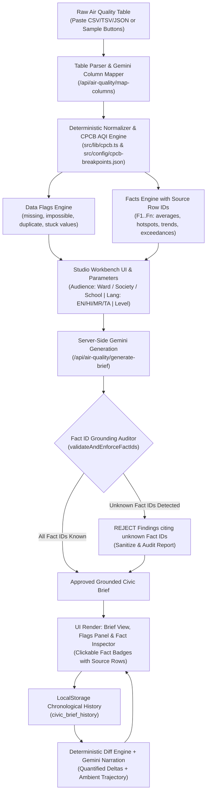

# Civic Air Quality Briefing Studio

An accountable, domain-grounded Next.js platform that ingests raw ambient air quality tables, extracts auditable mathematical facts and sensor flags in deterministic code, and synthesizes audience-targeted civic briefings with a live server-side Gemini call whose every finding is checked against the computed Fact IDs.

**For evaluators:** no login is needed. Open the app, click a sample dataset (the Mumbai one contains stuck, missing and negative readings), pick an audience, language and reading level, and press **Generate Civic Briefing**. Click any `F#` badge to see the exact source rows behind it. Generate a second time with a different dataset to see the comparison with the previous brief.

---

## 1. System Architecture & Flow



### End-to-End Pipeline
1. **Table Ingestion & Mapping**:
   - Accepts CSV, TSV, DSV, or JSON data.
   - Users can choose from 3 pre-verified sample datasets (Delhi Ward Sensor Network, Bengaluru Housing Society, Mumbai School District Anomaly Data).
   - The studio maps column headers and units in the browser with a deterministic heuristic (`heuristicMapColumns`: station/time/PM2.5/PM10/NO2/SO2/CO/O3/AQI, ppb/ppm conversion). A Gemini-assisted mapping endpoint exists at `/api/air-quality/map-columns`, but the studio UI does not call it yet.
2. **Deterministic Code Normalization & CPCB AQI**:
   - Calculates CPCB sub-indices for PM2.5, PM10, NO2, SO2, CO, and O3 using official linear interpolation formulas.
   - Determines overall AQI ($AQI = \max(I_p)$) and categorizes into CPCB NAQI bands: *Good, Satisfactory, Moderate, Poor, Very Poor, Severe*.
3. **Data Quality & Sensor Flags Engine**:
   - Deterministically detects:
     - `missing`: Missing station names or absent pollutant measurements.
     - `impossible`: Negative concentrations ($< 0$) or physically implausible readings (e.g. PM2.5 $> 1500\ \mu g/m^3$, AQI $> 1000$).
     - `duplicate`: Repeated timestamps for identical stations.
     - `stuck_value`: Frozen sensor transducers reporting identical non-zero values across $\ge 3$ consecutive cycles.
   - **Invariant: Flagged data is NEVER hidden.** Surfaced in a dedicated high-contrast Flags Audit Panel and in the telemetry table.
   - **Rows with an `impossible` or `duplicate` flag are excluded from computed facts** (averages, hotspots, exceedances, trends) so a broken sensor cannot become a "hotspot". Missing and stuck readings stay in the facts and are reported in the data-integrity fact.
4. **Verifiable Facts Engine (`F1`..`Fn`)**:
   - Generates numbered Fact IDs (`F1`, `F2`, ...) with 1-based source row references:
     - Regional and station-wise averages
     - Peak pollution hotspots and cleanest zones
     - CPCB 24-hr standard exceedance counts
     - Per-station trends (first vs last reading at the same station; never compared across stations)
     - Telemetry integrity ratios
5. **Audience Configuration & Generation**:
   - **Audience**: *Ward Officer & Municipal Administration*, *Housing Society Committee & Residents*, *School Principals & Teachers*. Each audience is given its own set of action levers in the prompt (`AUDIENCE_ACTION_FOCUS`), e.g. dust suppression and enforcement for wards, generator scheduling for societies, indoor assembly and PE for schools. Changing a parameter after generating shows a "Regenerate" banner so a stale brief is never mistaken for the new selection.
   - **Languages**: *English*, *Hindi (हिंदी)*, *Marathi (मराठी)*, *Tamil (தமிழ்)*.
   - **Reading Levels**: *Executive* (action-oriented bullet points), *Standard* (balanced civic rationale), *Accessible* (plain language for citizens).
6. **Server-Side Briefing Generation & Fact ID Enforcement**:
   - `/api/air-quality/generate-brief` invokes Gemini on the server with strict system instructions and response schemas.
   - **Invariant: Reject findings citing unknown Fact IDs.** Any finding referencing hallucinated IDs not in $\{F1..Fn\}$ is rejected by the server validation auditor (`brief-validator.ts`).
   - **Invariant: No medical advice.** Instructions and post-audits ensure advisories are strictly civic and public health operational guidance (masks, HEPA filtration, avoiding outdoor exertion, consulting physicians for medical issues).
7. **Chronological Diff Engine**:
   - Saves generated briefings in `localStorage` under `civic_brief_history`.
   - On subsequent briefings, the code computes mathematical deltas (average AQI delta, category shift, hotspot movements, flag count changes) and Gemini narrates the ambient shift.

---

## 2. CPCB Breakpoints Configuration

The Indian Central Pollution Control Board (CPCB) National Air Quality Index (NAQI) breakpoints are stored in `src/config/cpcb-breakpoints.json`:

| Category | AQI Range | PM2.5 (24-hr $\mu g/m^3$) | PM10 (24-hr $\mu g/m^3$) | NO2 (24-hr $\mu g/m^3$) | SO2 (24-hr $\mu g/m^3$) | CO (8-hr $mg/m^3$) | O3 (8-hr $\mu g/m^3$) |
|---|---|---|---|---|---|---|---|
| **Good** | 0 – 50 | 0 – 30 | 0 – 50 | 0 – 40 | 0 – 40 | 0 – 1.0 | 0 – 50 |
| **Satisfactory** | 51 – 100 | 31 – 60 | 51 – 100 | 41 – 80 | 41 – 80 | 1.1 – 2.0 | 51 – 100 |
| **Moderate** | 101 – 200 | 61 – 90 | 101 – 250 | 81 – 180 | 81 – 380 | 2.1 – 10.0 | 101 – 168 |
| **Poor** | 201 – 300 | 91 – 120 | 251 – 350 | 181 – 280 | 381 – 800 | 10.1 – 17.0 | 169 – 208 |
| **Very Poor** | 301 – 400 | 121 – 250 | 351 – 430 | 281 – 400 | 801 – 1600 | 17.1 – 34.0 | 209 – 748 |
| **Severe** | 401 – 500 | 250+ | 430+ | 400+ | 1600+ | 34.0+ | 748+ |

Sub-index interpolation formula:
$$I_p = \frac{I_{Hi} - I_{Lo}}{B_{Hi} - B_{Lo}} \times (C_p - B_{Lo}) + I_{Lo}$$

---

## 3. Prompting Approach & Safety Guardrails

### Guardrail Invariants
- **Zero Hallucination / Zero Invented Data**: The LLM is prohibited from inventing numbers, locations, dates, or readings. It is provided a pre-computed Fact table (`F1..Fn`) and must strictly cite Fact IDs.
- **Fact Citation Enforcement**: Server-side auditor inspects every finding's `factIds`. If an unknown ID (e.g. `F99`) is cited, the finding is immediately rejected.
- **No Medical Advice**: Advisories cannot prescribe medicines, suggest drug dosages, or diagnose clinical conditions. Guidance is restricted to civic operational actions:
  - Mask wearing (N95 particulate respirators)
  - Staying indoors during morning peak inversion hours
  - Running indoor HEPA air filtration
  - Sprinkling water / misting for dust suppression
  - Suspending outdoor physical education classes
  - Directing symptomatic individuals to consult licensed healthcare professionals.
- **Transparent Anomaly Retention**: Anomalies detected by the Flags Engine are explicitly surfaced in the UI flags panel and retained in telemetry audit tables.

### System Prompt Structure (`src/lib/gemini-brief.server.ts`)
```text
You are the Lead Environmental AI Analyst for the Civic Air Quality Briefing Studio.
Your role is to produce high-integrity, audience-targeted, and actionable civic briefings based EXCLUSIVELY on verified tabular facts.

CRITICAL GUARDRAILS & INVARIANTS:
1. ZERO HALLUCINATION: You must NEVER invent numbers, locations, dates, or measurements. You may ONLY state findings that directly cite the provided Fact IDs.
2. STRICT FACT CITATION: Every item in "findings" MUST include "factIds" referencing existing Fact IDs.
3. ABSOLUTELY NO MEDICAL ADVICE: Formulate public health guidance strictly in terms of civic advisories.
4. AUDIENCE SPECIALIZATION: Tailor prioritized actions and internal briefing note specifically for {audienceLabel}.
5. LINGUISTIC LOCALIZATION: Output all textual content in {langLabel}.
6. READING LEVEL: Follow the reading level tone: {readingLevelGuide}.
7. SENSITIVE ADVISORIES: Provide explicit citizen guidance partitioned for: General public, Children, Older adults, and Sensitive individuals.
8. RETURN VALID JSON: Conforming strictly to the requested schema.
```

---

## 4. Test Suite Coverage

Vitest test suites run across all core computational engines:

```bash
npm run test
```

### Verified Test Suites:
1. **`cpcb.test.ts`**:
   - Sub-index linear interpolation for PM2.5 and PM10 across all breakpoint boundaries.
   - CPCB Category categorization (Good, Satisfactory, Moderate, Poor, Very Poor, Severe).
   - Max sub-index AQI aggregation.
2. **`table-parser.test.ts`**:
   - Multi-delimiter parsing (CSV, TSV, DSV, JSON).
   - Heuristic column and unit recognition.
   - 1-based source row index preservation.
3. **`flags-and-facts.test.ts`**:
   - Anomaly detection: `missing` values, `impossible` negative readings, `duplicate` timestamps, and `stuck_value` frozen sensors.
   - Fact generation: averages, hotspots, cleanest zones, CPCB standard exceedances.
   - Traceable source row mapping.
4. **`messy-data.test.ts`**:
   - Semicolon-delimited input with quoted commas, unicode units, `NA`/`--`/blank cells, ppb conversion.
   - Every flag type with exact source rows; impossible/duplicate rows excluded from facts.
   - Trend facts never mix stations; every fact cites existing rows and IDs run `F1..Fn`.
5. **`gemini-brief.test.ts`**:
   - Each audience produces different action instructions; language and reading level switch the prompt.
   - Every fact ID and flag row reaches the prompt; newlines in data cannot inject instructions.
6. **`brief-validator.test.ts`**:
   - Strict rejection of findings citing unknown or hallucinated Fact IDs (`F99`).
   - Clean citation pass-through and grounding score calculation.
7. **`diff-engine.test.ts`**:
   - Quantified delta computation (average AQI, category transition, hotspot movements, flag deltas).
   - First-run baseline handling and chronological narrative generation.

---

## 5. Setup & Local Development

### 1. Install Dependencies
```bash
npm install
```

### 2. Environment Variables
Copy `.env.example` to `.env` in `apps/web`:
```env
GEMINI_API_KEY=your_gemini_api_key_here
GEMINI_MODEL=gemini-3.5-flash-lite
GEMINI_FALLBACK_MODELS=gemini-3.1-flash-lite,gemini-3.6-flash
NODE_ENV=development
```
- **Primary Model**: Uses `GEMINI_MODEL` (e.g. `gemini-3.5-flash-lite`).
- **Resilient Fallback Chain**: If the primary model encounters rate limits or errors, it automatically falls back sequentially across `GEMINI_FALLBACK_MODELS` (`gemini-3.1-flash-lite`, `gemini-3.6-flash`, `gemini-2.5-flash`).
- **Active Model Reflection**: The model that actually answered is shown in the brief header when the server returns it.

### 3. Run Development Server
```bash
npm run dev
# or
npm run dev:web
```
Access the studio at `http://localhost:3001` or `http://localhost:3000`.

### 4. Run Test Suite
```bash
npm run test
```

### 5. Type Check & Production Build
```bash
npm run check-types
npm run build
```
